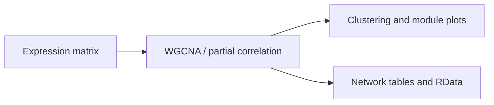

# Co-expression network analysis

This repository runs the existing WGCNA and partial-correlation analysis through a Nextflow DSL2 workflow. The workflow makes the input matrix, selected sample columns, resource limits, and output directory configurable while keeping the R analysis in a separate script.

## Quick start

Install Nextflow and Conda, then use the included stub profile to check the workflow graph:

```bash
nextflow run . -profile test -stub
```

Run the analysis with your data:

```bash
nextflow run . -profile conda --input expression.tsv --sample_columns 8,14,15,5,6,7 --outdir results
```

The matrix must be tab-delimited, contain a `Gene` column, and include the columns selected by `--sample_columns` (1-based column numbers). The default selection preserves the original script's six-sample selection. Supply at least four sample columns.

## Workflow



## Configuration

`nextflow.config` provides the Conda profile, output location, and sample-column selection. `environment.yml` defines the R packages. Use `--sample_columns` to select a different group of samples. Outputs are published under `results` by default.

## License

MIT. See [licence.txt](licence.txt).
